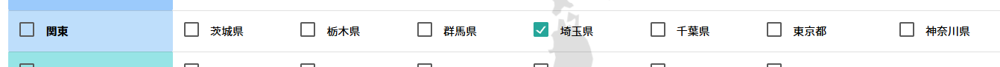
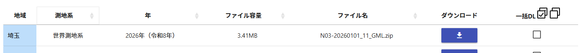
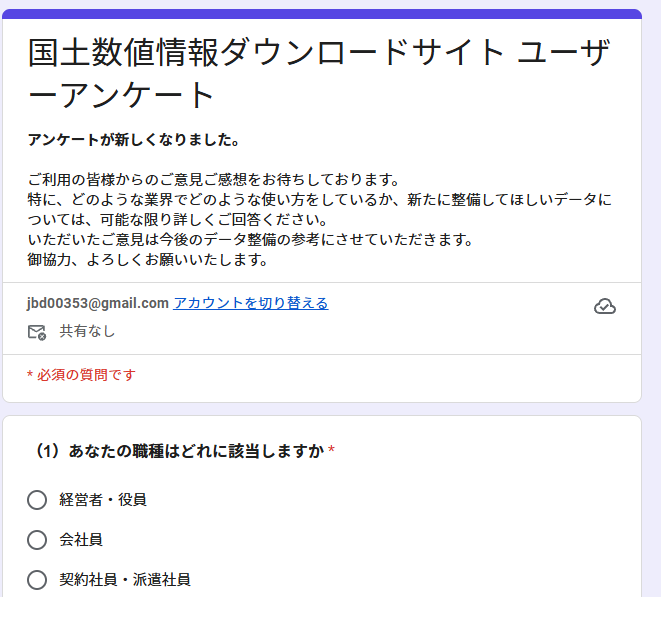
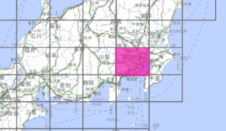
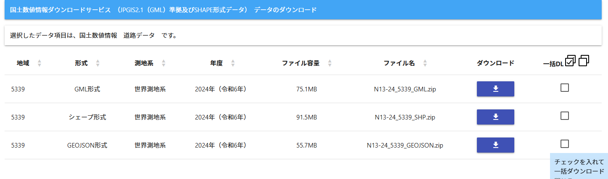
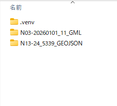

# はじめに
webページで坂戸市の道路を幅員ごとに色分け表示します。道路データはgeojson形式でローカルに持っています。

動作確認
- https://sakadocityroads.netlify.app/


# 環境
- WSL
  ```
  PS C:\Users\tatam> wsl --version
  WSL バージョン: 2.6.3.0
  カーネル バージョン: 6.6.87.2-1
  WSLg バージョン: 1.0.71
  MSRDC バージョン: 1.2.6353
  Direct3D バージョン: 1.611.1-81528511
  DXCore バージョン: 10.0.26100.1-240331-1435.ge-release
  Windows バージョン: 10.0.26300.9711
  ```

# 地図の表示

ローカルのhttpサーバーを立ち上げます。

```
python -m http.server 8000
```

ブラウザで```http://localhost:8000/```を開くと地図が表示されます。


# データ作成

## Python

Pythonで道路データから表示したい地域の道路を抽出します。

以下のライブラリが必要です。
- geopandas

```
python -m venv .venv
. .venv/bin/activate
pip install geopandas
```

## 道路データのダウンロード

表示したい市町村の道路データを用意します。道路のデータをダウンロードする前に、都道府県の形状のデータをダウンロードします。このデータは、道路が指定の市町村にあるのかどうかの判定に使用します。

[国土数値情報ダウンロードサイト](https://nlftp.mlit.go.jp/ksj/gml/datalist/KsjTmplt-N03-2026.html#!)から、ダウンロードしたい都道府県を選択します。

ここでは埼玉県のデータをダウンロードします。


都道府県を選択すると、ダウンロードできるデータが年ごとにに表示されていますので、必要なものを選択してください。

ここでは、最新のデータを選択します。


ダウンロードボタンをクリックするとアンケートが表示されます。

スキップしてもダウンロードはできます。

以上で、行政区域データをダウンロードできました。
次に道路データをダウンロードします。

[国土数値情報ダウンロードサイト/道路データ](https://nlftp.mlit.go.jp/ksj/gml/datalist/KsjTmplt-N13-2024.html)から表示したい道路が含まれるメッシュを選択します。



ダウンロードできる形式の選択ができるので、geojson形式を選択してダウンロードします。



データのダウンロードができました。次にデータの抽出をしていきます。上でダウンロードしたファイルを適当なフォルダに展開してください。


表示したい市町村の形状データを抽出します。

```
(.venv) PS C:\Users\tatam\roaddata> python "C:\Users\tatam\Projects\myproj\SakadoRoads\tools\extract_municipality_shape.py" -i .\N03-20260101_11_GML\N03-20260101_11.geojson -o sakado-shape.json 坂戸市
坂戸市の形状をsakado-shape.jsonに出力しました
(.venv) PS C:\Users\tatam\roaddata> python "C:\Users\tatam\Projects\myproj\SakadoRoads\tools\extract_roads_in_municipality.py" -s .\sakado-shape.json -r .\N13-24_5339_GEOJSON\N13-24_5339.geojson -o sakado_roads.json
抽出した道路データを保存しました: sakado_roads.json
```
ここでは、埼玉県坂戸市の道路を抽出してsakado_roads.jsonファイルに出力しました。

出力された```sakado_roads.json```はweb/dataへコピーします。


# 抽出したデータの表示

render.jsで読み込む道路データのパスと表示位置を設定しています。

```javascript
// 道路データのパス
const roaddataset = "./data/sakado_roads.json";
// 地図の初期化
const map = L.map("map").setView([35.9572819, 139.4004482], 15);
```

必要に応じで上記の部分を書き換えてください。```roaddataset```は抽出した道路データのファイルのパスです。二行目の```setView```で最初に表示する経緯度とズームレベルを指定しています。

